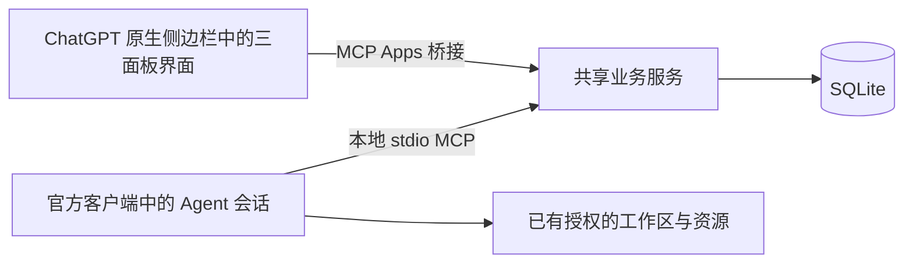

# 架构与边界

## 产品与协作内核

三个 Tab 读写同一业务服务：任务管理采用紧凑状态看板，资源池采用列表，共享面板仅以只读记录流展示协作事件。Agents 通过 MCP 读写相同的数据。界面不会模拟后台 Agent，服务也没有中心编排模型。

任务看板在可用窗口高度内保持各状态列等高，任务较多时只在该列内部纵向滚动。列宽至少 240px，窄窗口以看板内横向滚动保留状态顺序，不挤压列宽或改为多行。键盘可聚焦看板滚动区域，也可逐个聚焦任务卡片。

卡片只展示两行标题、最多两行说明及参与者数量／已有资源摘要；隐藏独立 UUID 行与空资源提示，说明中的 UUID 仅在摘要中缩写。完整标题、说明、标识和资源信息仍可通过任务详情查看，保存内容不变。

- `src/store.ts`：输入验证、状态变更、版本检查、归属检查、SQLite 事务及事件。
- `src/harness/`：与宿主无关的会话契约（`contract.ts`）、后端注册与配置装配（`registry.ts`，`SWARMBOARD_HARNESS`）及确定性 echo 参考后端；官方 Codex 适配位于 `src/codex-session.ts`。见 [Harness 适配与扩展](harness-adapters.md)。
- `src/collaborators.ts`：宿主接入的外部协作者——独立稳定身份、显式范围、终态撤销、成本记录与拉取式更新。见 [外部协作者](external-collaborators.md)。
- `src/app.ts`：本地 HTTP API、Streamable HTTP MCP 传输、同源和可选 Bearer 检查。
- `src/mcp.ts`：工具、协作 prompt、`board_open` 和 UI 资源注册；声明官方 `global` / `thread` entrypoints。
- `src/stdio.ts`：由桌面宿主启动的本地 stdio 服务，正常输出仅用于 MCP 协议。
- `src/paths.ts`：在用户数据目录保存共享 SQLite，以模块相对路径寻找随包界面。
- `scripts/build-desktop.mjs`：把 Node 服务及依赖打成单一 ESM 文件，白名单复制插件、界面和 skill。
- `web/`：中文 React 三面板。嵌入时使用官方 MCP Apps `App` 桥接；独立浏览器连接同源 API。
- `scripts/build-ui.mjs`：将代码和样式打包到一个 HTML；界面不依赖外部 CDN、图片或字体。

## 协作语义

任务状态为 `todo → in_progress → in_review → done`，也支持 `blocked` 和 `canceled`。这是一组状态，不要求所有任务遵循单一路径。加入目标检查当前版本并原子写入参与者、状态和事件；局部 CLAIM 同样加入参与。多个代理可以共同参与并以绑定身份修改目标，人类可以编辑或退回待认领。

资源不固定分类，也没有全局“被占用”布尔值。新建资源不要求 `kind`；旧数据库列与显式 API 字段保留兼容，编辑未提供时保留原值及既有能力信息。每条使用声明描述主体、目的、范围、共享条件与关联任务；多个活跃声明可以共存。共享消息用于协商，协议不穷举资源兼容组合。临时独占需求属于某一次使用，须说明具体范围、原因和结束条件；发布声明不代表已获得独占或同伴已确认。当前没有强制互斥确认，不能据此保证实际操作不会碰撞。修改与释放须使用声明拥有者身份和当前版本。声明变化不会操作实际资源。

事件追加后不可修改或删除，类型包括 `OBSERVED`、`FACT`、`FAIL`、`CLAIM`、`PATCH_SUMMARY` 和 `MESSAGE`。任务和资源的管理变化也进入时间线。`context_read` 按游标有界读取，避免每次返回完整历史；`board_read` 返回当前实体与最近 100 条记录。界面每 15 秒刷新快照，隐藏时暂停。

Agent 心跳是会话活动信息。界面把超过两分钟未报告的会话标记为“最近未报告”，不会据此释放其声明，也不会推断机器进程已经退出。重连时应核实旧声明与实际工作状态。

领域变更和对应事件在同一 SQLite 事务中提交。更新携带 `expectedVersion`；冲突后应重新读取并调整意图，不能自动覆盖他人更新。数据库以 `user_version` 管理迁移，拒绝读取比当前实现更新的模式。

## 原生会话接入

桌面 `global` 入口按 OpenAI 扩展协议使用带 composer 的会话布局，插件作为永久内容 Tab；`thread` 入口可在已有会话中打开看板。插件不自建聊天面板，也不控制宿主的左右布局、模型或审批模式。

顶部不提供全局讨论按钮；任务详情保留“讨论此任务”。UI 只在用户点击任务讨论入口后调用 `ui/message`。必须同时收到宿主的 `message.text` 与 `experimental["openai/message"]` 能力声明，才使用 `_meta["openai/message"] = { target: "active", send: false }` 追加可编辑草稿。这样保留当前会话和已有草稿，不自动发送，也不隐式新建会话。宿主拒绝或连接失败时展示失败，不改用自动发送模式重试。独立 HTTP 预览不模拟原生会话。

传入上下文只包含选中任务的有限已保存信息，作为数据与规划约定分开。规划提示与 `planning_partner` MCP prompt 要求先讨论、再预览任务，用户明确确认添加后才调用写入工具；这是 Agent 行为约定，不是对所有模型行为的服务端强制状态机。讨论入口本身只发送草稿请求，不写任务、资源或共享事件。

参考：[官方扩展指南](https://developers.openai.com/plugins/build/extensions)、[全局入口协议](https://github.com/openai/mcp-extensions/blob/main/docs/spec.md#global-entrypoint)、[消息扩展协议](https://github.com/openai/mcp-extensions/blob/main/docs/spec.md#prompt-target-and-send-behavior)。真实桌面布局与完整模型协作仍需宿主验收；模拟宿主测试只验证实际协议请求和隔离服务的业务结果。

## 平等同伴的事件运行时

默认三个同伴围绕同一组人类目标自行声明贡献与协商，运行时只管理容量、事件和生命周期。内部子问题只写共享面板，后台 MCP 不暴露创建任务或编辑资源定义；人类目标采用多参与者，局部 CLAIM 自动加入，工具校验绑定身份。成员可按预算请求扩容，人类可增加成员，原身份与会话保留。CI 采用持久 SHA 订阅，通知全体相关成员。Git 源项目为每位同伴提供独立检出和 .git，避免共享文件并发覆盖。代码整合和验证仍由同伴在授权范围内完成，运行时不自动合并业务代码。

持久事件向相关平等同伴传播；忙碌时排队，并在成功 MCP 工具返回附加新记录。无可推进目标的空队列不启动模型；有目标却全员空闲时由持久检查点限次提醒原会话，不创建任务级定时聊天。全部目标完成／取消后关闭空闲模型进程，受阻／待验收时等待事件；版本化停止控制阻止新回合并允许安全收尾。新目标复用同一组织。生产事件入口不初始化宿主 cron，兼容接口不代表定时会话会继续创建。

专用官方 Codex App Server 使用正常 CLI 登录、workspace-write 和 on-request，不自动审批、不从任务文字推导目录授权。不确定投递先核查，不盲目重放。协作内核不依赖具体 harness：会话差异在适配层，后端身份与 worker 持久绑定，跨后端不解释旧会话标识；详细契约、能力矩阵与新增后端步骤见 [Harness 适配与扩展](harness-adapters.md)，绑定、恢复、工具范围和验收见[事件工作会话](event-workers.md)。

## 与 Agensh 的关系

本轮对照了论文附录 A 的完整 worker prompt 和附录 B 的投递机制：所有成员使用同一协作协议，自主发现范围、交流冲突、验证并整合后继续选择工作。控制流不编码任务分配、固定角色、整卡排他认领或先完成一个目标再处理下一个。人类要求内部子问题只进入共享面板，因此没有照搬论文示例中新建 Gitea issue 的做法。普通事件在回合边界排队，私信和共享发现也附在基础设施工具返回中；这些不代表任意 Shell 进程会被抢占。每个会话一次维持一个模型回合是传输约束，不是人类目标配额。

思想来源：[Agensh 论文](https://arxiv.org/html/2609.26781v1)。共享工作区、消息和上下文共同支持 `gather → claim → act → verify → merge`，而不是仅靠一块文字面板。

Swarmboard 自行实现任务、资源、追加事件与 MCP 接口。已有工作区中的代码和文档仍由客户端操作；任务描述和成果摘要可保存路径或 URL 引用。运行时只准备隔离 Git 检出；实际验证与整合由同伴执行，不由中心调度模型安排。

本次实现未取得所查上游源码（链接返回 404），因此不声称依赖或复现上游 Agensh 内核。通用资源共享、产品界面和官方客户端接入是本项目的设计。已执行三个真实同伴围绕单个合成目标的协作验收；未进行论文性能、成本或广泛业务能力复现实验。

## 运行与信任

默认环回地址、单个可信空间。Agent ID 仅标识协作主体，不是独立认证证据。拥有服务访问权的客户端可以执行可信管理操作；不提供对抗性多租户隔离。

桌面插件通过根 `mcp.json` 的 stdio 配置启动，`${PLUGIN_ROOT}` 指向安装目录；服务和依赖随包分发，不要求先运行 HTTP 服务、公网部署或隧道。`board_open` 工具通过 OpenAI MCP Extensions 声明全局侧边栏和会话面板入口。MCP Apps HTML 仍然是 Web 技术界面，由桌面宿主嵌入；这不等于浏览器扩展，也不修改客户端 DOM。

本地 stdio 供在本机运行、且支持本地插件的会话使用。桌面客户端可以显示云端会话，但这不意味着该会话能够调用本机 stdio 服务；客户端的执行环境和工具可用性必须实际确认。UI 的 15 秒刷新只更新人看到的快照，不代表 Agent 主动读取，也不触发会话执行或自动唤醒。

默认数据库保存在用户数据目录，多个本地进程通过 SQLite 共享数据；插件更新不覆盖数据库。协作方必须使用同一数据库文件。包只包含固定白名单文件，不包含数据库、环境变量、运行记录或 `node_modules`。

HTTP 服务保留作开发预览及其他 MCP 客户端接入。可选 `BOARD_TOKEN` 仅用于 HTTP 服务访问认证，不属于模型凭据；普通浏览器不提供令牌粘贴入口。桌面 stdio 不监听网络端口。

本地 marketplace 是桌面开发安装路径；公开 GitHub 或 ZIP 不等于目录上架。官方本地 MCP 公开目录提交需要获批合作方组织 allowlist。真实宿主安装与自动化协议验证分别记录于 verification.md。

参考：[原生扩展](https://developers.openai.com/plugins/build/extensions)、[本地 marketplace](https://developers.openai.com/plugins/build/plugins)、[桌面本地 MCP](https://developers.openai.com/plugins/deploy/desktop-only)。

服务不读取订阅登录文件，不接管 OAuth，不直接调用模型 API。明确登记的事件 worker 由官方 Codex CLI 维护模型执行和权限；当前策略仅允许内部官方会话协作，不启动或续发外部 harness。声明不是系统锁，也不会强制阻止绕过协作约定的直接资源操作。

## 桌面启动环境

macOS/Linux 的构建产物通过允许的裸命令 `sh` 启动包内 `server/launch.sh`，由其发现 Node.js 24+ 并校验内置 SQLite；Windows 构建继续使用 Node 命令。来源中的标准 `mcp.json` 在构建阶段生成对应启动配置，包内路径仍使用 `${PLUGIN_ROOT}`。启动器仅查找运行时，不读写协作数据、不加载 shell 配置、不改变用户全局环境；最终服务沿用原有数据目录。
