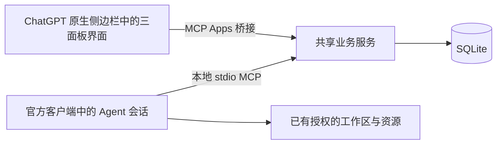

# 架构与边界

## 产品与协作内核

三个 Tab 读写同一业务服务：任务管理采用紧凑状态看板，资源池采用列表，共享面板仅以只读记录流展示协作事件。Agents 通过 MCP 读写相同的数据。界面不会模拟后台 Agent，服务也没有中心编排模型。

- `src/store.ts`：输入验证、状态变更、版本检查、归属检查、SQLite 事务及事件。
- `src/app.ts`：本地 HTTP API、Streamable HTTP MCP 传输、同源和可选 Bearer 检查。
- `src/mcp.ts`：工具、协作 prompt、`board_open` 和 UI 资源注册；声明官方 `global` / `thread` entrypoints。
- `src/stdio.ts`：由桌面宿主启动的本地 stdio 服务，正常输出仅用于 MCP 协议。
- `src/paths.ts`：在用户数据目录保存共享 SQLite，以模块相对路径寻找随包界面。
- `scripts/build-desktop.mjs`：把 Node 服务及依赖打成单一 ESM 文件，白名单复制插件、界面和 skill。
- `web/`：中文 React 三面板。嵌入时使用官方 MCP Apps `App` 桥接；独立浏览器连接同源 API。
- `scripts/build-ui.mjs`：将代码和样式打包到一个 HTML；界面不依赖外部 CDN、图片或字体。

## 协作语义

任务状态为 `todo → in_progress → in_review → done`，也支持 `blocked` 和 `canceled`。这是一组状态，不要求所有任务遵循单一路径。认领检查当前版本并原子写入归属、状态和事件。代理以自己的身份修改已认领任务；人类管理操作可以编辑任务并将其退回待认领。

资源不固定分类，也没有全局“被占用”布尔值。新建资源不要求 `kind`；旧数据库列与显式 API 字段保留兼容，编辑未提供时保留原值及既有能力信息。每条使用声明描述主体、目的、范围、共享条件与关联任务；多个活跃声明可以共存。共享消息用于协商，协议不穷举资源兼容组合。临时独占需求属于某一次使用，须说明具体范围、原因和结束条件；发布声明不代表已获得独占或同伴已确认。当前没有强制互斥确认，不能据此保证实际操作不会碰撞。修改与释放须使用声明拥有者身份和当前版本。声明变化不会操作实际资源。

事件追加后不可修改或删除，类型包括 `OBSERVED`、`FACT`、`FAIL`、`CLAIM`、`PATCH_SUMMARY` 和 `MESSAGE`。任务和资源的管理变化也进入时间线。`context_read` 按游标有界读取，避免每次返回完整历史；`board_read` 返回当前实体与最近 100 条记录。界面每 15 秒刷新快照，隐藏时暂停。

Agent 心跳是会话活动信息。界面把超过两分钟未报告的会话标记为“最近未报告”，不会据此释放其声明，也不会推断机器进程已经退出。重连时应核实旧声明与实际工作状态。

领域变更和对应事件在同一 SQLite 事务中提交。更新携带 `expectedVersion`；冲突后应重新读取并调整意图，不能自动覆盖他人更新。数据库以 `user_version` 管理迁移，拒绝读取比当前实现更新的模式。

## 原生会话接入

桌面 `global` 入口按 OpenAI 扩展协议使用带 composer 的会话布局，插件作为永久内容 Tab；`thread` 入口可在已有会话中打开看板。插件不自建聊天面板，也不控制宿主的左右布局、模型或审批模式。

UI 只在用户点击讨论入口后调用 `ui/message`。必须同时收到宿主的 `message.text` 与 `experimental["openai/message"]` 能力声明，才使用 `_meta["openai/message"] = { target: "active", send: false }` 追加可编辑草稿。这样保留当前会话和已有草稿，不自动发送，也不隐式新建会话。宿主拒绝或连接失败时展示失败，不改用自动发送模式重试。独立 HTTP 预览不模拟原生会话。

传入上下文只包含当前看板摘要或选中任务的有限已保存信息，作为数据与规划约定分开。规划提示与 `planning_partner` MCP prompt 要求先讨论、再预览任务，用户明确确认添加后才调用写入工具；这是 Agent 行为约定，不是对所有模型行为的服务端强制状态机。讨论入口本身只发送草稿请求，不写任务、资源或共享事件。

参考：[官方扩展指南](https://developers.openai.com/plugins/build/extensions)、[全局入口协议](https://github.com/openai/mcp-extensions/blob/main/docs/spec.md#global-entrypoint)、[消息扩展协议](https://github.com/openai/mcp-extensions/blob/main/docs/spec.md#prompt-target-and-send-behavior)。真实桌面布局与完整模型协作仍需宿主验收；模拟宿主测试只验证实际协议请求和隔离服务的业务结果。

## 与 Agensh 的关系

思想来源：[Agensh 论文](https://arxiv.org/html/2609.26781v1)。共享工作区、消息和上下文共同支持 `gather → claim → act → verify → merge`，而不是仅靠一块文字面板。

Swarmboard 自行实现任务、资源、追加事件与 MCP 接口。已有工作区中的代码和文档仍由客户端操作；任务描述和成果摘要可保存路径或 URL 引用。服务没有托管 Git、自动运行验证或自动合并代码。

本次实现未取得所查上游源码（链接返回 404），因此不声称依赖或复现上游 Agensh 内核。通用资源共享、产品界面和官方客户端接入是本项目的设计。尚未进行真实多模型协作效果、token 成本或论文性能复现实验。

## 运行与信任

默认环回地址、单个可信空间。Agent ID 仅标识协作主体，不是独立认证证据。拥有服务访问权的客户端可以执行可信管理操作；不提供对抗性多租户隔离。

桌面插件通过根 `mcp.json` 的 stdio 配置启动，`${PLUGIN_ROOT}` 指向安装目录；服务和依赖随包分发，不要求先运行 HTTP 服务、公网部署或隧道。`board_open` 工具通过 OpenAI MCP Extensions 声明全局侧边栏和会话面板入口。MCP Apps HTML 仍然是 Web 技术界面，由桌面宿主嵌入；这不等于浏览器扩展，也不修改客户端 DOM。

本地 stdio 供在本机运行、且支持本地插件的会话使用。桌面客户端可以显示云端会话，但这不意味着该会话能够调用本机 stdio 服务；客户端的执行环境和工具可用性必须实际确认。UI 的 15 秒刷新只更新人看到的快照，不代表 Agent 主动读取，也不触发会话执行或自动唤醒。

默认数据库保存在用户数据目录，多个本地进程通过 SQLite 共享数据；插件更新不覆盖数据库。协作方必须使用同一数据库文件。包只包含固定白名单文件，不包含数据库、环境变量、运行记录或 `node_modules`。

HTTP 服务保留作开发预览及其他 MCP 客户端接入。可选 `BOARD_TOKEN` 仅用于 HTTP 服务访问认证，不属于模型凭据；普通浏览器不提供令牌粘贴入口。桌面 stdio 不监听网络端口。

本地 marketplace 是桌面开发安装路径；公开 GitHub 或 ZIP 不等于目录上架。官方本地 MCP 公开目录提交需要获批合作方组织 allowlist。真实宿主安装与自动化协议验证分别记录于 verification.md。

参考：[原生扩展](https://developers.openai.com/plugins/build/extensions)、[本地 marketplace](https://developers.openai.com/plugins/build/plugins)、[桌面本地 MCP](https://developers.openai.com/plugins/deploy/desktop-only)。

服务不读取订阅登录文件，不接管 OAuth，不调用模型 API，不创建模型 worker。Agent 的持续运行与唤醒由其原有客户端决定。声明不是系统锁，也不会强制阻止绕过协作约定的直接资源操作。
