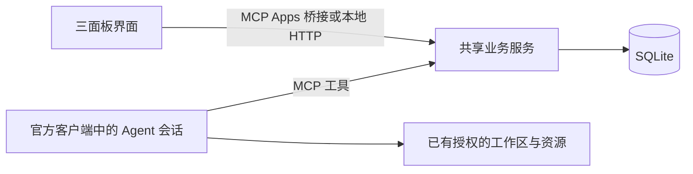

# 架构与边界

## 产品与协作内核

三个面板读写同一业务服务：任务面板与资源池供人管理，共享面板仅展示协作事件。Agents 通过 MCP 读写相同的数据。界面不会模拟后台 Agent，服务也没有中心编排模型。

- `src/store.ts`：输入验证、状态变更、版本检查、归属检查、SQLite 事务及事件。
- `src/app.ts`：本地 HTTP API、Streamable HTTP MCP 传输、同源和可选 Bearer 检查。
- `src/mcp.ts`：工具、协作 prompt、`board_open` 和 UI 资源注册。
- `web/`：中文 React 三面板。嵌入时使用官方 MCP Apps `App` 桥接；独立浏览器连接同源 API。
- `scripts/build-ui.mjs`：将代码和样式打包到一个 HTML；界面不依赖外部 CDN、图片或字体。

## 协作语义

任务状态为 `todo → in_progress → in_review → done`，也支持 `blocked` 和 `canceled`。这是一组状态，不要求所有任务遵循单一路径。认领检查当前版本并原子写入归属、状态和事件。代理以自己的身份修改已认领任务；人类管理操作可以编辑任务并将其退回待认领。

资源没有全局“被占用”布尔值。每条使用声明描述主体、目的、范围、共享条件与关联任务；多个活跃声明可以共存。共享消息用于协商，协议不穷举资源兼容组合。修改与释放须使用声明拥有者身份和当前版本。声明变化不会操作实际资源。

事件追加后不可修改或删除，类型包括 `OBSERVED`、`FACT`、`FAIL`、`CLAIM`、`PATCH_SUMMARY` 和 `MESSAGE`。任务和资源的管理变化也进入时间线。`context_read` 按游标有界读取，避免每次返回完整历史；`board_read` 返回当前实体与最近 100 条记录。界面每 15 秒刷新快照，隐藏时暂停。

Agent 心跳是会话活动信息。界面把超过两分钟未报告的会话标记为“最近未报告”，不会据此释放其声明，也不会推断机器进程已经退出。重连时应核实旧声明与实际工作状态。

领域变更和对应事件在同一 SQLite 事务中提交。更新携带 `expectedVersion`；冲突后应重新读取并调整意图，不能自动覆盖他人更新。数据库以 `user_version` 管理迁移，拒绝读取比当前实现更新的模式。

## 与 Agensh 的关系

思想来源：[Agensh 论文](https://arxiv.org/html/2609.26781v1)。共享工作区、消息和上下文共同支持 `gather → claim → act → verify → merge`，而不是仅靠一块文字面板。

Swarmboard 自行实现任务、资源、追加事件与 MCP 接口。已有工作区中的代码和文档仍由客户端操作；任务描述和成果摘要可保存路径或 URL 引用。服务没有托管 Git、自动运行验证或自动合并代码。

本次实现未取得所查上游源码（链接返回 404），因此不声称依赖或复现上游 Agensh 内核。通用资源共享、产品界面和官方客户端接入是本项目的设计。尚未进行真实多模型协作效果、token 成本或论文性能复现实验。

## 运行与信任

默认环回地址、单个可信空间。Agent ID 仅标识协作主体，不是独立认证证据。拥有服务访问权的客户端可以执行可信管理操作；不提供对抗性多租户隔离。

可选 `BOARD_TOKEN` 用于服务访问认证，不属于模型凭据。普通浏览器 UI 不提供粘贴令牌入口；认证模式应由 MCP 客户端安全传递 Bearer。ChatGPT 私有测试可以连接受控、可达的 HTTPS MCP 入口，也可以使用官方 Secure MCP Tunnel 连接私有服务。隧道需要 Platform tunnel ID、运行密钥和相应工作区权限；不等于直接向云端提供 localhost。公开插件提交仍需公网 HTTPS 入口。仓库未创建部署、隧道、运行密钥或正式客户端注册，也未完成真实宿主连接。

参考：[连接 ChatGPT](https://developers.openai.com/plugins/deploy/connect-chatgpt)、[Secure MCP Tunnels](https://developers.openai.com/api/docs/guides/secure-mcp-tunnels)。

服务不读取订阅登录文件，不接管 OAuth，不调用模型 API，不创建模型 worker。Agent 的持续运行与唤醒由其原有客户端决定。声明不是系统锁，也不会强制阻止绕过协作约定的直接资源操作。
